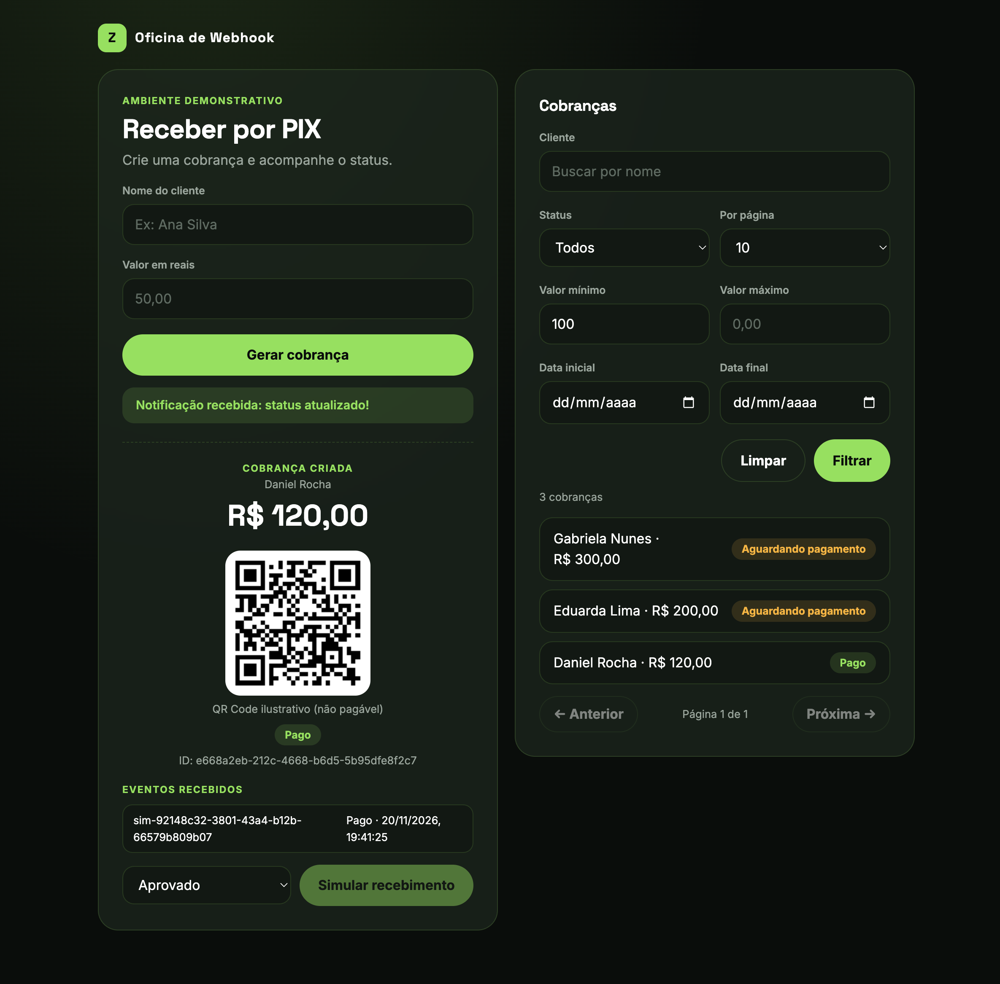

# Cobranças e notificações por webhook




Sistema **demonstrativo** (Node.js + Express + MySQL) para criar cobranças, consultá-las e acompanhar o status por webhook. Não realiza pagamentos reais e o QR Code é apenas ilustrativo.

## Requisitos

- Node.js 20 ou superior
- MySQL 8 em execução (ex.: `docker run -d --name mysql -p 3306:3306 -e MYSQL_ROOT_PASSWORD=root mysql:8`)

## Início rápido com Docker

```bash
docker compose up --build
```

Sobe o MySQL e a aplicação juntos, cria o banco automaticamente e deixa tudo em http://localhost:3000 (token do webhook: `token-da-application`).

## Instalação sem Docker

```bash
npm install
cp .env.example .env
```

Edite o `.env` com os dados do seu MySQL e rode:

```bash
npm run db:init
npm start
```

Acesse http://localhost:3000.

## Variáveis de ambiente

| Variável | Descrição | Padrão |
|---|---|---|
| `PORT` | Porta do servidor | `5000` |
| `MYSQL_HOST` | Host do MySQL | `localhost` |
| `MYSQL_PORT` | Porta do MySQL | `3306` |
| `MYSQL_USER` | Usuário | `root` |
| `MYSQL_PASSWORD` | Senha | vazio |
| `MYSQL_DATABASE` | Banco da aplicação | obrigatório |
| `MYSQL_TEST_DATABASE` | Banco usado nos testes | `webhook_test` |
| `WEBHOOK_TOKEN` | Token exigido no header `x-webhook-token` | `new-token` |

## Banco de dados

`npm run db:init` cria o banco (se não existir) e executa o `database.sql`:

- `pagamentos`: `id`, `cliente`, `valor`, `status`, `criado_em`, `atualizado_em`
- `eventos_webhook`: `evento_id` (chave primária), `pagamento_id`, `status`, `processado_em`

A chave primária de `eventos_webhook` garante que o mesmo evento nunca seja processado duas vezes, mesmo com requisições simultâneas. O processamento acontece em uma transação (pagamento bloqueado com `FOR UPDATE`, evento registrado e status atualizado juntos).

## Rotas da API

| Método | Rota | Descrição | Sucesso | Erros |
|---|---|---|---|---|
| POST | `/pagamentos` | Cria cobrança (`cliente`, `valor`) | 201 | 400 |
| GET | `/pagamentos` | Lista cobranças com filtros e paginação (ver abaixo) | 200 | 400 |
| GET | `/pagamentos/:id` | Consulta uma cobrança | 200 | 400, 404 |
| GET | `/pagamentos/:id/eventos` | Lista os eventos de webhook processados para a cobrança | 200 | 400, 404 |
| POST | `/webhook/pagamento` | Recebe atualização de status (header `x-webhook-token`) | 200 | 400, 401, 404, 409 |
| GET | `/saude` | Verifica se o servidor está online | 200 | |
| POST | `/simulacao/webhook` | Usado pela interface para simular uma notificação | 200 | 400, 404, 409 |

Filtros de `GET /pagamentos` (todos opcionais e combináveis):

| Parâmetro | Descrição |
|---|---|
| `status` | `pending`, `approved`, `rejected` ou `cancelled` |
| `cliente` | Nome do cliente (busca parcial, sem diferenciar maiúsculas) |
| `valorMin` / `valorMax` | Faixa de valor (maior ou igual a zero) |
| `de` / `ate` | Período de criação, formato `AAAA-MM-DD` (inclui o dia final inteiro, em UTC) |
| `limite` / `pagina` | Paginação (limite de 1 a 100, padrão 20) |

Status de cobrança: `pending`, `approved`, `rejected`, `cancelled`. O webhook aceita `approved`, `rejected` e `cancelled`.

Respostas do webhook:

- `200` com `"duplicado": false`: evento processado.
- `200` com `"duplicado": true`: evento já processado antes, nada é alterado.
- `401`: token ausente ou inválido.
- `400`: `pagamentoId` (UUID), `status` ou `eventoId` inválidos.
- `404`: pagamento não existe.
- `409`: pagamento já finalizado (não é possível mudar o status novamente).
- `503`: banco de dados indisponível.

## Exemplos de requisições

Criar cobrança:

```bash
curl -X POST http://localhost:3000/pagamentos \
  -H "Content-Type: application/json" \
  -d '{"cliente":"Ana Silva","valor":50.5}'
```

Consultar:

```bash
curl http://localhost:3000/pagamentos/<ID>
```

Listar e filtrar por status:

```bash
curl "http://localhost:3000/pagamentos"
curl "http://localhost:3000/pagamentos?status=pending&limite=10&pagina=1"
curl "http://localhost:3000/pagamentos?cliente=ana&valorMin=10&valorMax=100&de=2026-11-01&ate=2026-11-30"
```

Enviar webhook:

```bash
curl -X POST http://localhost:3000/webhook/pagamento \
  -H "Content-Type: application/json" \
  -H "x-webhook-token: <WEBHOOK_TOKEN>" \
  -d '{"pagamentoId":"<ID>","status":"approved","eventoId":"evt-001"}'
```

O arquivo `requisicoes.http` traz todos os exemplos (VS Code com a extensão REST Client, ou JetBrains).

Repetir o mesmo comando retorna `"duplicado": true`. Com token errado retorna `401`.

## Testes

Os testes usam o MySQL real em um banco separado (`MYSQL_TEST_DATABASE`, criado automaticamente), então o MySQL precisa estar rodando:

```bash
npm test
```

Os testes também rodam automaticamente no GitHub Actions a cada push.

Cobertura: criação, consulta, listagem com todos os filtros e paginação, histórico de eventos, atualização de status, persistência após reconectar, evento duplicado (inclusive concorrente), token inválido, dados inválidos e códigos HTTP.

## Estrutura

```
server.js                    inicialização
database.sql                 esquema
scripts/initDb.js            cria banco e tabelas
src/app.js                   Express, rotas e tratamento de erros
src/validacao.js             validação dos dados
src/routes/                  pagamentos, webhook, simulação
src/services/webhookService  transação do webhook
src/store/                   conexão MySQL e consultas
src/public/index.html        interface
tests/                       testes automatizados (API e validação)
requisicoes.http             exemplos de requisições
```
